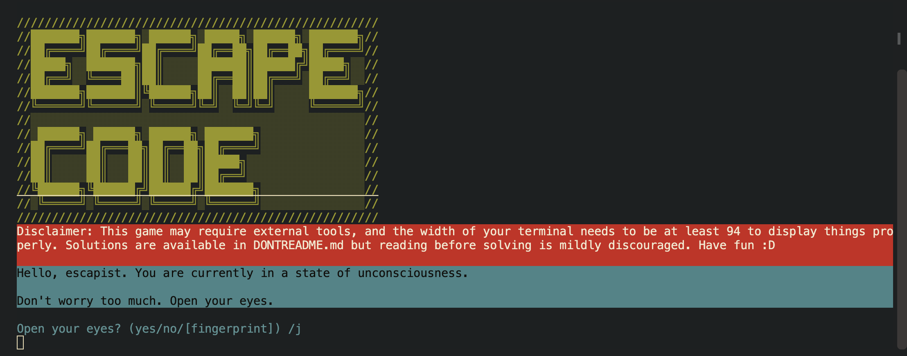

# ESCAPE CODE

## HOW TO LOG IN
Type `ssh escapist@2a01:4f9:3a:276e::1342 -p 1` into the terminal. 
Once prompted, type in the password `goodbye world`. 
You'll know you've successfully logged in once you see: 

## SOLUTIONS
Solutions are available in the DONTREADME.md file, but I strongly encourage you try it out first :D

## FEEDBACK
I'm very open to criticism TT 
The story did a 180° I believe. At first it was supposed to be darker, but I realised that reading a huge wall of text was going to be really boring, so I made the ending a bit more interactive and less dark, that's why it's (kind of) rushed. Thanks to anyone willing to play my game :D